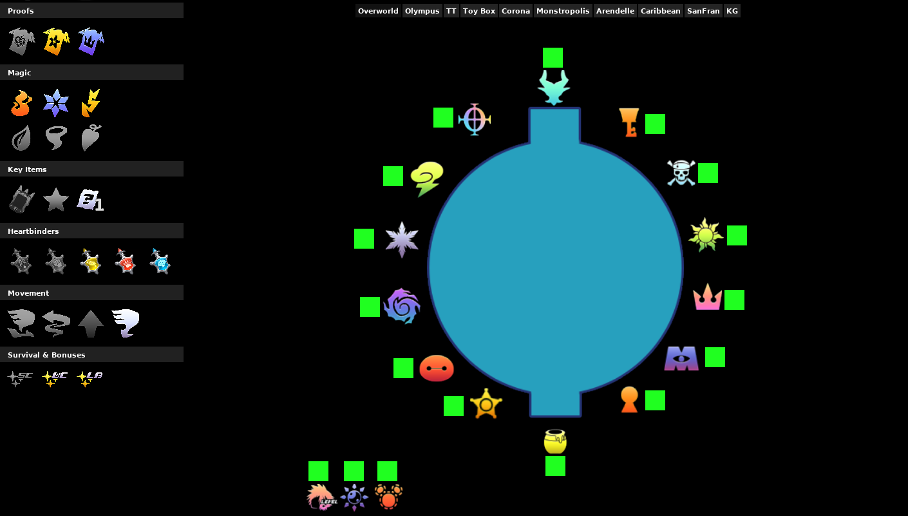

# KH3 Archipelago PopTracker Pack
A PopTracker pack for Kingdom Hearts III Archipelago randomizer.

## Installation
1. Download and extract to your PopTracker `packs/` directory
2. Open PopTracker and select "Kingdom Hearts III Archipelago"
3. Connect to your AP server for auto-tracking

## Logic
Access rules follow the KH3 apworld (0.17.x): world portals (keyblades, or party
members with Portal Unlocks), the tier-one keyblade gate of Data Battles,
Twilight Town and Caribbean combat gates, the movement and combat requirements
of each check, Chestsanity keyblades, Gummi space ships, and the goal items for
the final door.

When connected, the pack reads the seed's settings from the slot data (world
pools, Gummi space, Portal Unlocks, Chestsanity, Melody of Memory songs and
music chests, Lucky Emblem and Level Up limits...) and tracks items, checks and
photographed Lucky Emblems automatically.

## Credits
Built for use with the KH3 Archipelago alpha APWorld developed by Aesais.

Icon art from [Kingdom Hearts Re:Collection](https://televo.github.io/kingdom-hearts-recollection)
by Televo, used under its free-use terms.
