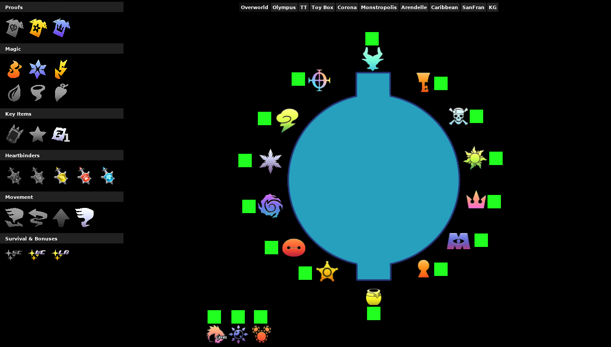

# KH3 Archipelago PopTracker Pack
A PopTracker pack for Kingdom Hearts III Archipelago randomizer.

## Installation
1. Download and extract to your PopTracker `packs/` directory
2. Open PopTracker and select "Kingdom Hearts III Archipelago"
3. Connect to your AP server for auto-tracking

## Apworld compatibility
The logic changes often between apworld versions: use the pack release made for yours.
Apworld downloads: https://ap.aesais.net/games/kingdom-hearts-iii

| Pack | Apworld |
|---|---|
| 1.1.0-beta.1 (pre-release) | 2.0.0 beta (build shared on 2026-11-10) |
| 1.0.1 | 1.0.0 to 1.0.2 |
| 1.0.0 | 1.0.0 to 1.0.2 |
| 0.4.6 | 0.16.x (alpha) |

## Logic
Access rules follow the KH3 apworld (2.0.0): world portals (keyblades, or party
members with Portal Unlocks), the tier-one keyblade gate of Data Battles,
Twilight Town and Caribbean combat gates, the movement and combat requirements
of each check, Chestsanity keyblades (Roxas opening Oblivion and Oathkeeper chests
with Roxas Chestsanity), Gummi space ships, and the goal items for
the final door, with the Worlds Required of the seed. Allies unlocked as
playable characters (Kairi, Roxas, Riku, Aqua) count as Doubleflight and Air
Slide, as in the apworld.

A check that only misses combat abilities shows yellow (sequence break) instead
of red, once its world is open and any movement it needs is collected: Block,
Air Slide, Dodge Roll, Cure and Magic, Twilight Town's defensive ability, the
extra defense of Grim Guardianess and Monstropolis' final fight, and the Data
Battles' abilities. The Combat Requirements setting switches back to red.

When connected, the pack reads the seed's settings from the slot data (world
pools, Gummi space, Portal Unlocks, Chestsanity, Melody of Memory songs and
music chests, Lucky Emblem and Level Up limits...) and tracks items, checks and
photographed Lucky Emblems automatically.

## Credits
Built for use with the KH3 Archipelago APWorld developed by Aesais.

Icon art from [Kingdom Hearts Re:Collection](https://televo.github.io/kingdom-hearts-recollection)
by Televo, used under its free-use terms.

Enemy portraits from the [Kingdom Hearts Wiki](https://www.khwiki.com).
